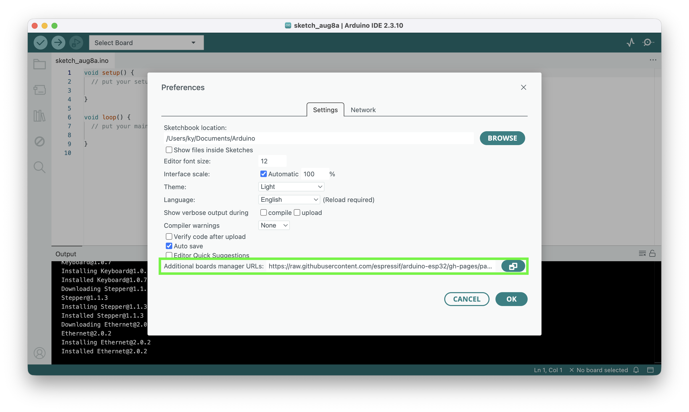
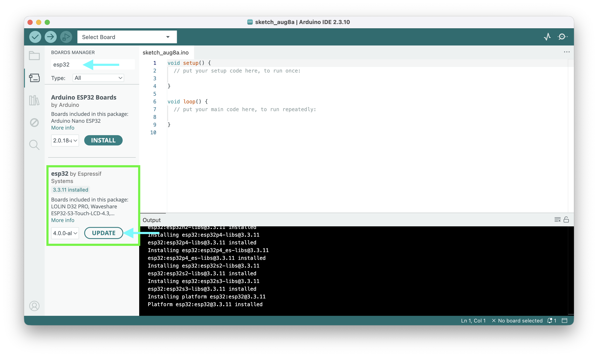
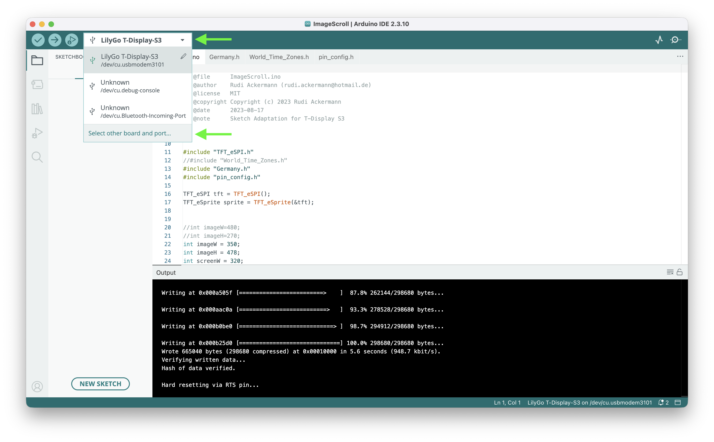
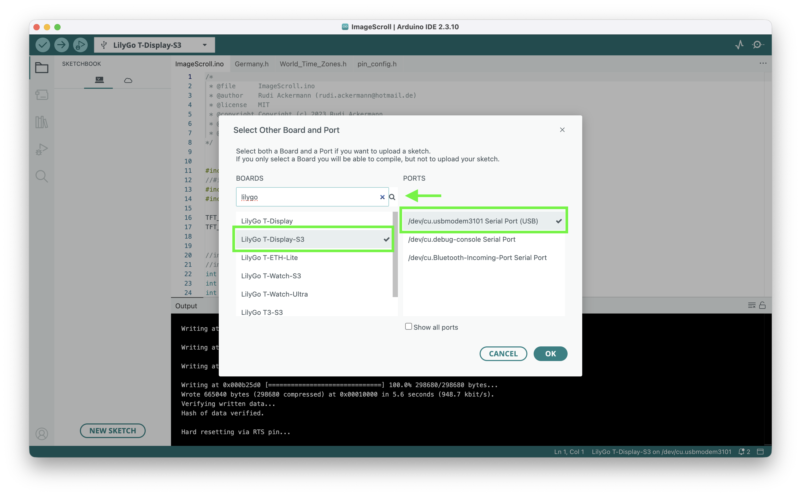

# Setting up the Lilygo T-Display-S3 development environment

The Lily T-Display-S3 is a development board with the [ESP32 microcontroller](https://en.wikipedia.org/wiki/ESP32). This post describes how to set up your Arduino IDE to program the board.

<!-- more -->

## Why the Lilygo T-Display-S3?

The ESP32 microcontroller have become popular for DIY electronics projects because it is has a fairly powerful dual core microprocessor and good peripheral support. The S3 in particular supports [USB On-The-Go](https://en.wikipedia.org/wiki/USB_On-The-Go), which allows the USB port to act in host mode. This is useful for receiving inputs from peripherals such as MIDI controllers or keyboards. The Lilygo T-Display-S3 additionally provides a 1.9 inch, 170x320 pixel LCD.


## Setting up your Arduino IDE

1. Install the [Arduino IDE](https://www.arduino.cc/en/software/).
2. Open the Arduino IDE
3. Add the ESP32 board manager to the board managers. Open the Settings add paste the link below into the “Additional board manager URLs” field. The board managers provide information required to compile the Arduino sketch for a specific board. You can read more about Arduino board managers [here](https://support.arduino.cc/hc/en-us/articles/360016119519-Add-boards-to-Arduino-IDE). `https://raw.githubusercontent.com/espressif/arduino-esp32/gh-pages/package_esp32_dev_index.json`
	

4. Confirm the ESP32 board manager is installed. Open the board manager from the menu: `Tools -> Board -> Board manager…` Then search for and select “esp32” by Espressif (makers of the ESP32). You may need to update the version from the dropdown menu.
   

## Download the Lilygo libraries and examples

The Lilygo developers have collected useful libraries and examples in the T-Display-S3 repository. Here we will download them and add the relevant libraries to the Arduino IDE.

1. Clone the Lilygo `T-Display-S3` repo
  ```bash
  git clone https://github.com/Xinyuan-LilyGO/T-Display-S3.git
  ```
2. You add libraries to the Arduino IDE by adding them to your Arduino libraries folder. Typically this is in `Documents/Arduino/libraries`. You may have to create the `libraries` subdirectory. The Arduino IDE will automatically look in this folder for libraries you include in your sketches. Copy the `TFT_eSPI` folder from `T-Display-S3/lib` into your Arduino libraries folder. The `TFT_eSPI` is a useful library for drawing graphics on the LCD.
3. Explore the other libraries in `T-Display-S3/lib` for inspiration.

## Upload your first sketch

The Lilygo `T-Display-S3` repo contains example sketches in `T-Display-S3/examples`. We will load a demo to verify that the IDE is set up properly.

1. Connect the Lilygo T-Display-S3 via the USB-C port to your computer.
2. Select the Lilygo T-Display-S3 board in the IDE via the board dropdown menu. This is how we tell the Arduino IDE which board and port to target for compilation and upload, respectively. If the board is not available in the menu, select “Select other board and port”. Then search for and select the Lilygo T-Display-S3 board. Use the usbmodem serial port (i.e., not the debug or bluetooth serial ports)
	
	
4. Open the example sketch. From the menus select `File -> Open` and then open to the `T-Display-S3/examples/ImageScroll/ImageScroll.ino` sketch.
5. Upload the sketch via the menu `Sketch -> Upload`
6. Once the sketch uploads, you should see a map of Germany scrolling on the display.

