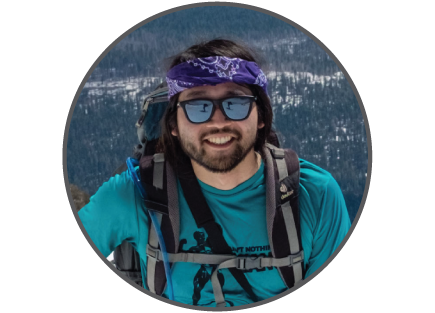

#

- 

- ## About me
  I am a co-founder and member of [Image Cooperative](https://image.coop/), a worker's cooperative of scientists and engineers developing, maintaining, and teaching open source software for imaging. I am excited about accelerating science by building interoperable tools for extracting meaning from images. Currently, I am working on [OME-Zarr](https://ngff.openmicroscopy.org/index.html) and developing software for smart microscopy. Additionally, I am a core developer of [napari](https://www.napari.org).

    Previously, I was a postdoctoral researcher in the Department of Biosystems Science and Engineering at the ETH Zürich where I developed new methods for inferring biophysical parameters from images and extracting multiscale morphological measurements from large images. I also worked as an R&D engineer in the Bioengineering platform at the Chan Zuckerberg Biohub. At the Biohub, I built hardware and software tools to make novel measurements on biological systems. In particular, I led the development of the in situ transcriptomics platform.

    Outside of the lab, you can find me skiing and climbing in the mountains.

